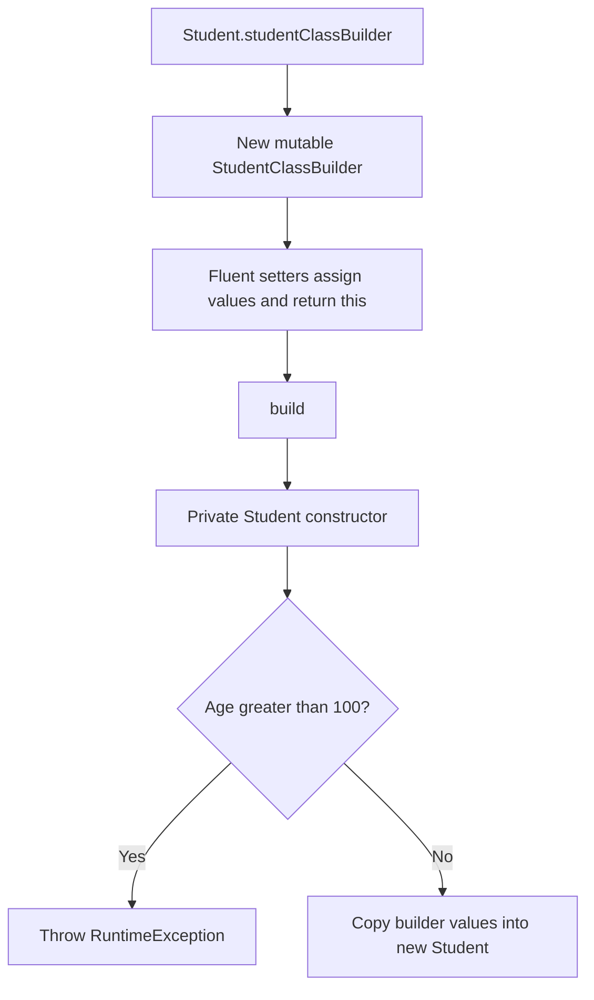

# Java Builder Pattern — Student Construction with a Fluent API

### Name each construction step. Keep object creation behind a controlled boundary.

A focused **Java creational-pattern example** that constructs a `Student` through a static nested builder. Fluent setters describe each supplied value, and `build()` delegates to a private constructor containing a simple age check.

[Student and builder implementation](./Student.java) · [Client example](./StudentClient.java)

> **Scope:** Small object-construction example on the `main` branch. It demonstrates a fluent API and one validation rule, not a student-management application or comprehensive domain validation. No compilation or tests were run for this documentation.

---

## The design problem

An object with several parameters can become difficult to read when its constructor is a long positional argument list. A builder gives each assignment a name and lets the caller omit fields it does not need.

This example separates mutable construction state from the created object's fields:

```java
Student student = Student.studentClassBuilder()
        .setName("Sam")
        .setAge(30)
        .setPsp(99.0)
        .setBatch("Academy")
        .build();
```

That is the construction flow in the committed client. `phoneNumber` is omitted and remains `null`.

## Practical value

| Requirement | Implementation |
|---|---|
| Make argument meaning visible | Named setter methods |
| Support step-by-step configuration | Setters return the same builder instance |
| Keep construction details together | Static nested `StudentClassBuilder` |
| Control ordinary object creation | Private `Student` constructor |
| Apply a rule at creation time | Reject age greater than 100 |

The design can inform configuration objects or request objects with optional values. Those are potential applications; this repository does not measure productivity or maintenance improvements.

## Construction flow



### Static factory entry point

`studentClassBuilder()` returns a new builder. The builder is static, so creating it does not require an existing `Student`. Its implicit public constructor also permits direct construction of the nested builder.

### Fluent setters

Each setter updates a builder field and returns `this`, enabling chaining. Validation does not occur in the setters.

### Build boundary

`build()` calls `new Student(this)`. The private constructor reads builder values through getters and assigns them to the new object. The getters belong to the builder; the resulting `Student` exposes no getters or setters in the current implementation.

The builder can be reused. Each successful `build()` creates a separate `Student`; changing the builder afterward does not reassign fields in an already built object. Current values are primitives and immutable strings, so there is no nested mutable-state copying to manage.

## Fields, defaults, and validation

| Field | Type | Default when omitted | Implemented validation |
|---|---|---|---|
| `name` | `String` | `null` | None |
| `phoneNumber` | `String` | `null` | None |
| `age` | `int` | `0` | Values above 100 throw |
| `batch` | `String` | `null` | None |
| `psp` | `double` | `0.0` | None |

Age 100 is accepted. Negative ages are not rejected. No required-field, blank-name, phone-format, or PSP-range rule is implemented.

The thrown `RuntimeException` has no explanatory message. A failed constructor does not return a `Student`, but the current error provides little guidance about the invalid value.

## Encapsulation and immutability boundaries

The product's fields are private, its constructor is private, and it has no public mutators. However, the class and fields are not declared `final`. It is best described as a construction-controlled object with no exposed mutation API, rather than a complete demonstration of every immutable-object design convention.

The pattern does not inherently guarantee valid objects: that depends on the checks implemented at the construction boundary. Here, only one age condition is checked.

## Expected client behavior

The client builds a student with name `Sam`, age 30, PSP 99.0, and batch `Academy`, then prints:

```text
DEBUG
```

It does not display the student's field values or assert their correctness. These values and output are inferred from the committed source, not recorded execution results.

## Compile and run

Both Java files declare:

```text
com.scaler.CreationalDesignPatterns.BuilderDesignPattern
```

Although the source files sit at repository root, `javac -d` can generate the matching package directories:

```bash
git clone https://github.com/FaiazS/Java-Builder-Design-Pattern-Example-Student-Class.git
cd Java-Builder-Design-Pattern-Example-Student-Class
javac -d out Student.java StudentClient.java
java -cp out com.scaler.CreationalDesignPatterns.BuilderDesignPattern.StudentClient
```

A JDK with `javac` is required. No tested JDK range, Maven/Gradle configuration, external dependencies, or automated test suite is committed. The commands were not executed during this review.

## Repository layout

```text
Java-Builder-Design-Pattern-Example-Student-Class/
├── README.md
├── Student.java
└── StudentClient.java
```

## Useful next steps

1. **Define domain rules:** Decide which fields are required and which values are valid.
2. **Make failures actionable:** Throw a specific argument-validation exception with a useful message.
3. **Make the result inspectable:** Add appropriate read access or a deliberate display method.
4. **Clarify immutability intent:** Consider final fields and a final class if those guarantees fit the model.
5. **Demonstrate boundary cases:** Add tests when extending for omitted values, age 100/101, negative ages, and builder reuse.
6. **Standardize project layout:** Align source directories with packages and add a build configuration if the exercise grows.

These are proposed improvements, not implemented capabilities.

## Skills demonstrated

**Java · Builder pattern · Fluent interfaces · Method chaining · Static nested classes · Static factory methods · Encapsulation · Constructor validation**

The portfolio contribution is a readable object-creation API with an explicit validation boundary. Stronger domain rules and observable examples would build on that foundation.

---

**Author:** [Faiaz Ahmed](https://www.linkedin.com/in/faiazahmed22/) · [GitHub](https://github.com/FaiazS)


